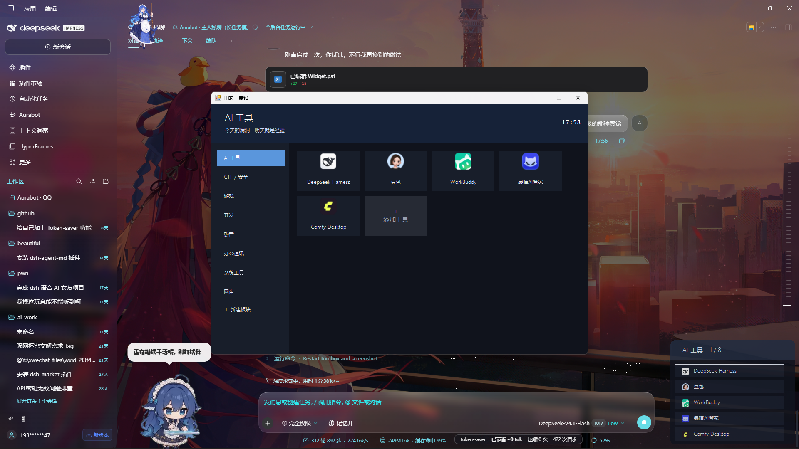

# AuraToolsBox · 桌面工具箱
Windows 轻量工具启动器，分组管理本地软件，附带桌面悬浮小窗快速切换板块。
**纯 PowerShell + WinForms 实现，无需安装第三方依赖。**




## ✨ 功能特性
- 主界面：左侧板块分组，右侧图标墙；自动从exe提取程序图标
- 可视化添加工具：选择exe/快捷方式，填写名称，配置自动保存
- 自定义板块分类；右键图标移除条目（**不会删除原程序文件**）
- 桌面浮窗：半透明玻璃圆角、可拖动；滚轮/方向键切换板块；60秒自动翻页
- 配置文件 `config.json`，支持手动编辑修改

## 🖥️ 运行环境
- Windows 10 / Windows 11
- 系统自带 **PowerShell 5.1**，不需要额外下载安装

## 🚀 快速上手
1. 下载仓库源码，把整个 `src` 文件夹解压到任意目录（例：`D:\Tools\AuraToolsBox`）
2. 双击 `启动工具箱.vbs` → 打开主管理界面
3. 双击 `启动浮窗.vbs` → 打开桌面悬浮小窗口
> 首次打开列表为空，点板块末尾「**＋ 添加工具**」来导入本地程序。

## ⚙️ 可选配置
### 开机自启浮窗
1. Win+R，输入 `shell:startup` 打开开机启动文件夹
2. 将 `启动浮窗.vbs` 创建快捷方式，拖入此文件夹

### config.json 配置格式
```json
{
  "title": "我的工具箱",
  "groups": [
    {
      "name": "AI工具",
      "items": [
        { "name": "示例软件", "path": "D:\\apps\\demo.exe", "args": "-参数" }
      ]
    }
  ]
}
