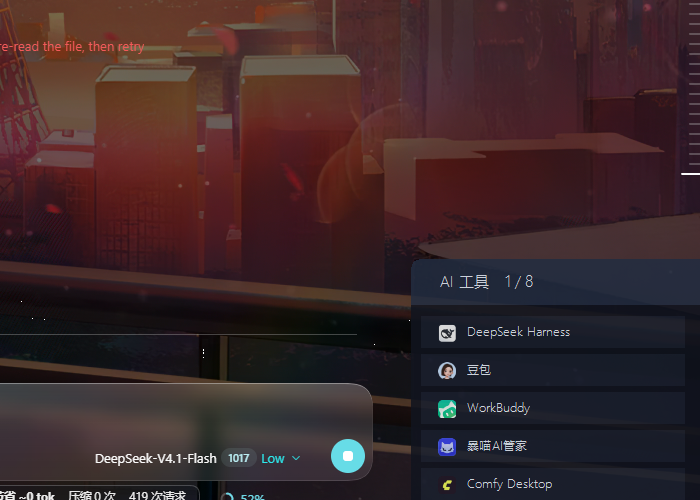

# AuraToolsBox · 桌面工具箱

一个 Windows 上的轻量工具启动器：分组管理常用程序，双击即开，配一个桌面浮窗随时切换板块。
纯 PowerShell + WinForms 写，不需要安装任何依赖。




## 特性

- 左侧板块分区，右侧图标墙，图标从 exe 自动提取
- 内置「添加工具」：选一个 exe 或快捷方式，起个名字就进列表，配置自动保存
- 「新建板块」自定义分类，右键图标可从列表移除（不删文件）
- 浮窗：半透明冷色玻璃风、圆角、可拖动、滚轮/方向键切换、60 秒自动翻页
- 配置就是一个 config.json，手改也行

## 运行环境

- Windows 10 / 11
- Windows 自带 PowerShell 5.1，无需额外安装

## 快速开始

1. 下载本仓库，把 `src` 文件夹解压到任意位置，比如 `D:\MyTools`
2. 双击 `启动工具箱.vbs` —— 主界面
3. 双击 `启动浮窗.vbs` —— 右下角的浮窗

第一次打开是空列表，点每个板块最后的「＋ 添加工具」往里加就行。

## 开机自启（可选）

按 `Win + R` 输入 `shell:startup`，把 `启动浮窗.vbs` 的快捷方式拖进去。

## 配置格式

```json
{
  "title": "我的工具箱",
  "groups": [
    {
      "name": "AI 工具",
      "items": [
        { "name": "示例程序", "path": "D:\\apps\\demo.exe", "args": "-flag" }
      ]
    }
  ]
}
```

`args` 可省略。路径失效的条目会显示「(未安装)」，不影响其他项。

## 操作提示

| 操作 | 说明 |
| --- | --- |
| 拖动浮窗 | 按住标题栏拖动，位置会被记住 |
| 切换板块 | 滚轮、方向键、PageUp/PageDown |
| 自动翻页 | 每 60 秒 |
| 关闭浮窗 | Esc 或右键菜单 |

## 目录结构

```
src/
  ToolBox.ps1        主界面
  Widget.ps1         桌面浮窗
  config.json        配置（空模板）
  启动工具箱.vbs      主界面启动器
  启动浮窗.vbs        浮窗启动器
docs/
  截图
```

## 常见问题

**双击没反应？** 右键 vbs 选「打开方式 → wscript.exe」。也可能是被安全软件拦了，白名单加一下。

**图标显示不对？** 图标是从目标 exe 里直接取的，取不到就用默认图。快捷方式会自动解析真实目标。

**改完配置要重启吗？** 关掉窗口再打开即可。

## License

MIT
